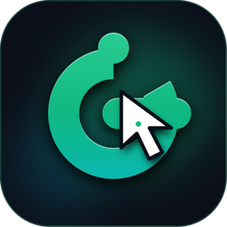

<p align="center">
  
</p>

<h1 align="center"><a href="https://github.com/benzntech/TwinFlow">GlideDesk</a></h1>

<p align="center">
  <b>Lightweight, Zero-Latency Software KVM (Tauri v2 + Rust)</b><br>
  Share one mouse, keyboard, and clipboard across Mac, Windows, Linux, and Android.<br>
  <b>15x Lower RAM. Zero-GC Latency. Instant Screen Transitions.</b>
</p>

<p align="center">
  
  
  
  
  
  
  
  
</p>

---

## ⚡ What is GlideDesk?

**GlideDesk** is a modern, high-performance software KVM switch built from the ground up on **Tauri v2 and asynchronous Rust**.

Move your mouse effortlessly past the edge of your monitor to seamlessly control your other Mac, Windows PC, or Linux workstation with zero physical cables, zero hardware switches, and zero lag.

---

### 🚀 Why GlideDesk? (Comparison with Traditional Electron KVMs)

Traditional software KVMs bundle full Chromium and Node.js runtimes, leading to high memory overhead and V8 Garbage Collection micro-stutters. GlideDesk uses native OS webviews and a Tokio async Rust engine:

| Benchmark / Attribute | Traditional Electron KVM | GlideDesk (Tauri v2 + Rust) | Advantage |
| :--- | :--- | :--- | :--- |
| **Idle Memory Footprint** | ~500 MB – 1.0 GB (5+ processes) | **~28 MB – 45 MB** (Single process) | **~15–20x lower RAM** |
| **Garbage Collection (GC)** | V8 Stop-The-World GC (1–3s latency spikes) | **Zero GC** (Deterministic deallocation) | **Zero cursor stutter** |
| **Installer Size** | ~130 MB – 180 MB | **~10 MB – 16 MB** | **~10x smaller download** |
| **Disk Installed Size** | ~380 MB | **~35 MB** | **~10x disk savings** |
| **Cold Startup Time** | ~1.6 – 2.4 seconds | **<350 ms** | **Instant launch** |
| **Headless Background Daemon** | High (full browser resident) | **~10 MB background service** | **Ideal for 24/7 background usage** |

---

## ✨ Features

- **Seamless Monitor Edge-Crossing**: Glide your cursor naturally across physical screens (Left, Right, Top, Bottom).
- **Zero-GC Determinism**: Input events stream through bounded channels in Rust with motion delta coalescing under network backpressure.
- **Unified Real-Time Clipboard**: Copy text or images on your Mac, paste immediately on Windows or Linux, with automatic loopback echo suppression.
- **Instant LAN Discovery**: Automatic peer discovery on UDP port `47801` without typing IP addresses.
- **Ultra-Light System Tray**: Run GlideDesk in the background consuming under 30 MB of RAM.
- **Universal Wire Compatibility**: Fully compatible with existing KVM network mesh protocols across macOS, Windows, Linux, and Android.

---

### 📱 Android Companion Features

GlideDesk includes a companion Android app (`android/`) for multi-device continuity:
- **Phone as Wireless Second Screen**: Extend your desktop onto an Android phone or tablet with smooth hardware-accelerated video streaming.
- **Touch Trackpad & Gamepad Mode**: Use your phone screen as an ultra-responsive wireless trackpad or gamepad for your PC over Wi-Fi or Bluetooth BLE.
- **Universal Clipboard Sync**: Copy text or pictures on your phone, paste immediately on your computer, and vice versa.
- **Notification & Call Mirroring**: View incoming phone alerts, texts, and caller IDs directly on your desktop screen.
- **Phone Camera as PC Webcam**: Turn your smartphone camera into a wireless HD webcam for desktop video calls.

---

## 🛠️ Building & Development

### Prerequisites
- [Rust toolchain](https://rustup.rs/) (stable)
- Node.js 18+
- On Linux: `libwebkit2gtk-4.1-dev libayatana-appindicator3-dev`
- On Windows: WebView2 (pre-installed on Windows 10/11)

### Quick Start
```bash
# Clone the repository
git clone https://github.com/benzntech/TwinFlow.git
cd TwinFlow

# Install dependencies
npm install

# Run in development mode
npm run dev

# Build production package
npm run build
```

---

## 📜 License

GlideDesk is free and open-source software licensed under the [GNU General Public License v3.0](LICENSE).
